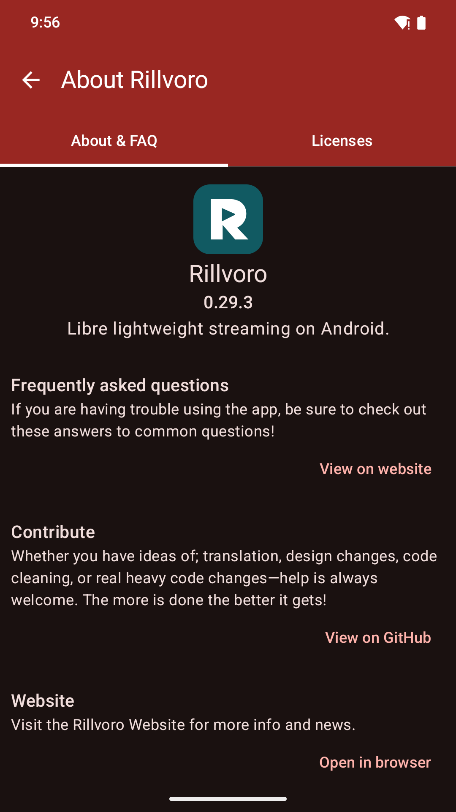

<p align="center"></p>
<h2 align="center"><b>Rillvoro</b></h2>
<h4 align="center">Eine freie, offene und leichtgewichtige Streaming App für Android.</h4>

Rillvoro ist ein unabhängiger Fork von [NewPipe](https://github.com/TeamNewPipe/NewPipe).

[English](/README.md) · [Deutsch](/doc/README.de.md) · [Español](/doc/README.es.md) · [Français](/doc/README.fr.md) · [हिन्दी](/doc/README.hi.md) · [Italiano](/doc/README.it.md) · [한국어](/doc/README.ko.md) · [Português do Brasil](/doc/README.pt_BR.md) · [Polski](/doc/README.pl.md) · [ਪੰਜਾਬੀ](/doc/README.pa.md) · [日本語](/doc/README.ja.md) · [うちなーぐち](/doc/README.ryu.md) · [Română](/doc/README.ro.md) · [Русский](/doc/README.ru.md) · [Soomaali](/doc/README.so.md) · [Türkçe](/doc/README.tr.md) · [正體中文](/doc/README.zh_TW.md) · [অসমীয়া](/doc/README.asm.md) · [Српски](/doc/README.sr.md) · [العربية](/doc/README.ar.md)

## Screenshots

[](/fastlane/metadata/android/en-US/images/phoneScreenshots/00.png)
[](/fastlane/metadata/android/en-US/images/phoneScreenshots/01.png)
[](/fastlane/metadata/android/en-US/images/phoneScreenshots/02.png)
[](/fastlane/metadata/android/en-US/images/phoneScreenshots/03.png)
[](/fastlane/metadata/android/en-US/images/phoneScreenshots/04.png)
[](/fastlane/metadata/android/en-US/images/phoneScreenshots/05.png)
[](/fastlane/metadata/android/en-US/images/phoneScreenshots/06.png)
[](/fastlane/metadata/android/en-US/images/phoneScreenshots/07.png)
[](/fastlane/metadata/android/en-US/images/phoneScreenshots/08.png)
<br/><br/>
[](/fastlane/metadata/android/en-US/images/tenInchScreenshots/09.png)
[](/fastlane/metadata/android/en-US/images/tenInchScreenshots/10.png)

## Unterstützte Dienste

* YouTube ([Webseite](https://www.youtube.com/)) und YouTube Music ([Webseite](https://music.youtube.com/)) ([Wiki](https://en.wikipedia.org/wiki/YouTube))
* PeerTube ([Webseite](https://joinpeertube.org/)) sowie all seine *Instanzen* (öffne die Webseite um herauszufinden was das bedeutet!) ([Wiki](https://en.wikipedia.org/wiki/PeerTube))
* Bandcamp ([Webseite](https://bandcamp.com/)) ([Wiki](https://en.wikipedia.org/wiki/Bandcamp))
* SoundCloud ([Webseite](https://soundcloud.com/)) ([Wiki](https://en.wikipedia.org/wiki/SoundCloud))
* media.ccc.de ([Webseite](https://media.ccc.de/)) ([Wiki](https://en.wikipedia.org/wiki/Chaos_Computer_Club))

## Beschreibung

Rillvoro holt sich die benötigten Daten über die offizielle API des jeweiligen Dienstes (z.B. PeerTube). Falls die offizielle API für unsere Zwecke zu eingeschränkt ist (z.B. YouTube), oder weil sie proprietär ist, wird die Webseite entweder *geparst* oder stattdessen eine interne API benutzt. Das heißt also, dass für keinen Dienst ein Account gebraucht wird, um Rillvoro zu benutzen.

Da außerdem sowohl die App als auch der Extractor frei und quelloffen sind, wird keine proprietäre Bibliothek und kein proprietäres Framework benutzt, wie z.B. Google Pay Services.
Rillvoro kann also unproblematisch auf Geräten und Custom ROMs benutzt werden, die keine Google Apps installiert haben.

### Features

* Sieh dir Videos mit einer Auflösung von bis zu 4K an
* Höre Audio im Hintergrund, wodurch nur der Audio Stream geladen wird, um Daten zu sparen
* Popup Modus ("schwebender Player", auch bekannt als Picture-in-Picture)
* Schaue Live Streams
* Ein- und Ausblenden von Untertitel
* Suche nach Videos und Musik (bei YouTube kann zusätzlich die Sprache des Inhalts festgelegt werden)
* Warteschlangen für Videos (speichere sie optional als lokale Playlists)
* Ein- und Ausblenden von allgemeinen Information über die Videos (z.B. Beschreibung und Tags)
* Ein- und Ausblenden von nächsten/ähnlichen Videos
* Ein- und Ausblenden der Kommentarsektion
* Suche Videos, Musik, Kanäle, Playlists und Alben
* Durchsuche Videos und Musik innerhalb eines Kanals
* Abonniere Kanäle (ja, ohne sich mit einem Account anzumelden!)
* Bekomme Benachrichtigungen für neue Videos von Kanälen, die du abonniert hast
* Erstelle und bearbeite Gruppen von Kanälen (um das Durchsuchen und Organisieren zu vereinfachen)
* Durchsuche Video Feeds, die aus deinen Kanalgruppen entstehen
* Schaue dir deinen Verlauf an und durchsuche ihn
* Suche und schaue dir Playlists an (Es handelt sich um „Remote Playlists“, die also vom Dienst abgerufen werden, den du gerade durchsuchst)
* Erstelle und bearbeite lokale Playlists (diese werden lediglich in der App gespeichert, also nicht im jeweiligen Dienst!)
* Nutze Videos/Audio/Untertitel offline
* Mit Kodi Medien öffnen
* Schaue oder blockiere altergeschützten Inhalt

## Installation und Updates

Installiere JDK 21 und das Android SDK und führe diese Befehle aus, um das Debug-APK zu bauen.

```sh
git clone https://github.com/culpen90/Rillvoro.git
cd Rillvoro
./gradlew :app:assembleDebug
```

Verbinde das Gerät, aktiviere USB-Debugging und starte

```sh
./gradlew :app:installDebug
```

## Beitrag

[Beitrag](/.github/CONTRIBUTING.md) · [GitHub Issues](https://github.com/culpen90/Rillvoro/issues)

## Privacy Policy

[Privacy Policy](/doc/privacy.md)

## Lizenz
[](https://www.gnu.org/licenses/gpl-3.0.de.html)

Rillvoro ist freie Software: Du kannst es nach Belieben benutzen, studieren, teilen, und verbessern.
Du kannst es insbesondere unter den Bedingungen der [GNU General Public License](https://www.gnu.org/licenses/gpl-3.0.de.html), wie von der Free Software Foundation veröffentlicht, entweder Version 3 der Lizenz oder (nach deiner Wahl) jede spätere Version, weiter verbreiten und/oder verändern.
